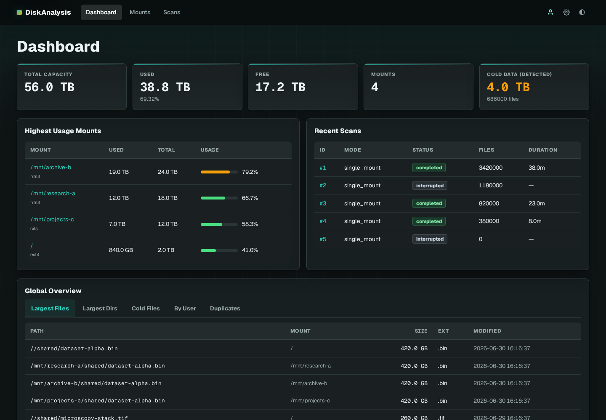
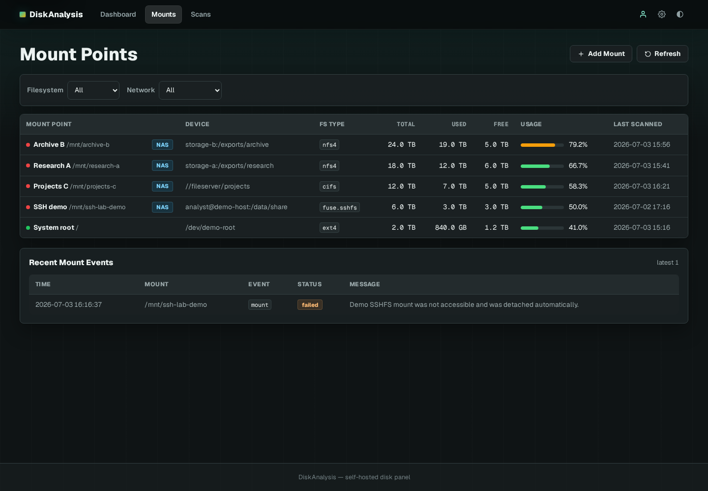
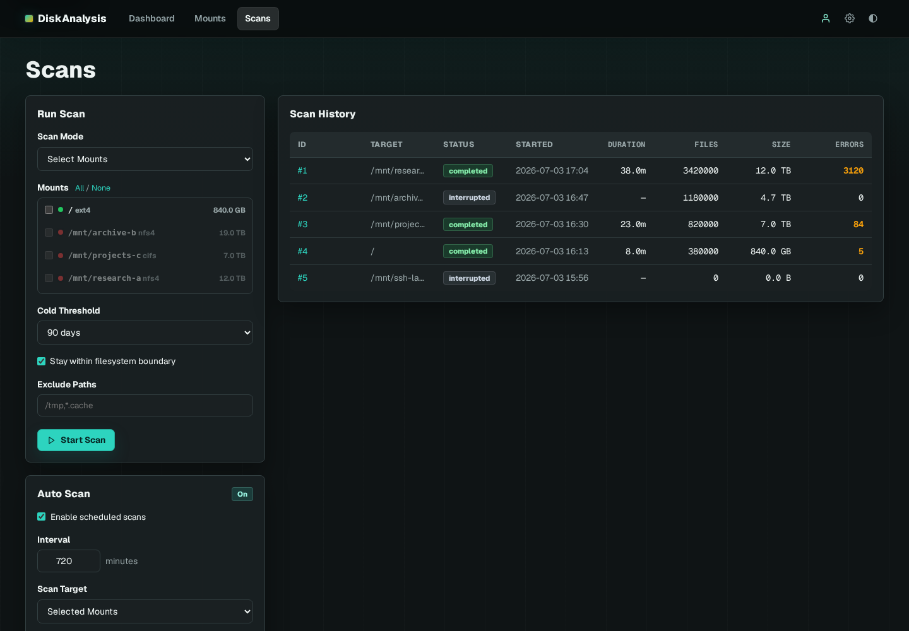
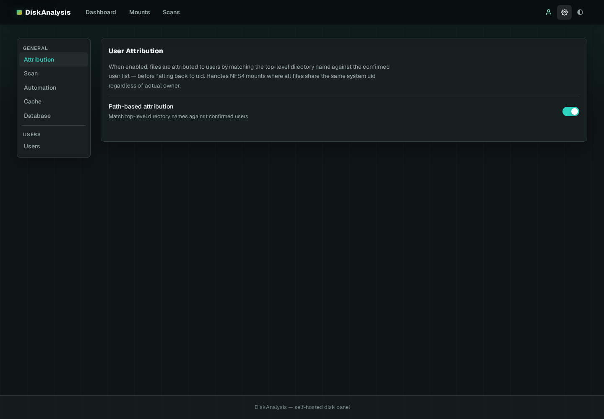

# DiskAnalysis

Self-hosted disk usage analytics for Linux servers with many local, NAS, NFS, SMB, and SSHFS mount points.

DiskAnalysis combines a host-aware scanner with a FastAPI/Jinja web UI. It is built for repeated operational use on research, lab, or homelab storage servers where a single machine may expose dozens of large mount points.



## Highlights

- **Mount inventory**: discover Linux mounts, track capacity, label mount points, and register custom NFS/SMB/SSHFS entries.
- **SSHFS operations from the web UI**: create mount directories, mount/unmount, lazy-detach stale FUSE mounts, remount historical SSHFS entries, and record recent mount events.
- **Full scans with live progress**: scan selected mounts, all accessible mounts, or a specific path. Scans run in subprocess workers so stuck network filesystem calls can be terminated.
- **Auto Scan**: schedule recurring full scans from the Scans page, with next-run, last-run, skip/failure messages, and active scan visibility.
- **Scan control**: stop one scan or batch-stop multiple running/queued scans from the UI.
- **Analytics views**: largest files, largest directories, cold data, extension breakdown, and per-user usage.
- **NFS/SMB user attribution**: path-based user attribution for uid-squashed filesystems, with confirmed users, aliases, candidates, and cache rebuilds.
- **Operational UI**: dark mode by default, compact tables, right-click and multi-select actions, and responsive public/admin states.
- **Optional admin auth**: leave `ADMIN_PASSWORD` empty for trusted single-user deployments, or set it to require login for write operations.

## Screenshots

| Dashboard | Mounts |
|---|---|
|  |  |

| Scans and Auto Scan | Settings |
|---|---|
|  |  |

More screenshot notes: [docs/screenshots.md](docs/screenshots.md).

## Quick Start

### 1. Prepare the project

```bash
git clone <your-repo-url> diskanalysis
cd diskanalysis

cp .env.example .env
mkdir -p data
```

Edit `.env` as needed:

```env
APP_PORT=8000
DB_PATH=/data/diskanalysis.db
ADMIN_PASSWORD=
PATH_USER_ATTRIBUTION=true
```

### 2. Start the web app

```bash
docker compose up -d
```

Open:

```text
http://localhost:8000
```

For host-local development:

```bash
python3 -m venv .venv
source .venv/bin/activate
pip install -r requirements.txt
uvicorn app.main:app --host 0.0.0.0 --port 8000
```

### 3. Run scans

From the web UI:

- Go to **Scans**.
- Choose **Select Mounts**, **All Mounts**, or **Specific Path**.
- Click **Start Scan**.
- Use **Auto Scan** on the same page for recurring full scans.

From the CLI:

```bash
python -m app.scanner doctor
python -m app.scanner mounts
python -m app.scanner scan --all-mounts
python -m app.scanner scan --mount /mnt/research-a
python -m app.scanner scan --path /mnt/research-a/project-alpha --cold-days 180
```

## Current Scan Model

DiskAnalysis intentionally runs **full scans only**. The previous incremental mode was removed because it still had to traverse the full directory tree and produced partial scan snapshots that could mislead capacity analytics.

Each completed scan writes a coherent snapshot for a mount/path:

- top largest files
- top cold files
- directory aggregates
- extension summaries
- uid/user summaries
- scan totals and error counts

## SSHFS Mount Management

The Mounts UI supports SSHFS entries with:

- password or key-based mount requests
- optional web-created local mount directories
- sudo mkdir mode for controlled mount-point creation
- stale FUSE health checks
- automatic lazy detach after failed or inaccessible SSHFS mounts
- remote-path diagnostics when sshfs exits but the mount point is not readable
- remount actions through context menus and selection menus
- recent mount event history

See [docs/deployment.md](docs/deployment.md) for required host packages and privilege notes.

## Documentation

- [Architecture](docs/architecture.md): process model, scanner workers, scheduler, SQLite layout.
- [Configuration](docs/configuration.md): `.env` settings and UI-backed settings.
- [Scanner](docs/scanner.md): host CLI commands and scan behavior.
- [Deployment](docs/deployment.md): Docker, host mode, nginx, systemd/cron, SSHFS prerequisites.
- [User Attribution](docs/user-attribution.md): directory-name attribution, uid fallback, aliases, cache behavior.
- [Recent Updates](docs/recent-updates.md): latest product and operational changes.
- [Screenshots](docs/screenshots.md): screenshot list and refresh commands.

## Project Structure

```text
diskanalysis/
├── app/
│   ├── main.py                  # FastAPI app, startup cleanup, scheduler startup
│   ├── config.py                # pydantic-settings .env config
│   ├── db.py                    # SQLAlchemy engine, SQLite WAL, lightweight migrations
│   ├── models.py                # Mount, Scan, File, Directory, ScanError, settings models
│   ├── scanner.py               # Host-side CLI entry point
│   ├── scan_worker.py           # Subprocess scan worker for web-triggered scans
│   ├── api/                     # JSON API routes
│   ├── services/                # scanner, analytics, mounts, scheduler
│   ├── templates/               # Jinja pages
│   ├── static/                  # CSS
│   └── web/                     # HTML page routes
├── docs/
│   └── assets/screenshots/      # GitHub README screenshots
├── deploy/                      # systemd timer/service examples
├── tests/
├── docker-compose.yml
├── Dockerfile
└── requirements.txt
```

## Testing

```bash
python -m pytest tests/ -q
```

Current known test debt: three legacy analytics tests expect older return shapes for largest-file/largest-directory helpers. The scan stop tests and mount detection tests pass.

## Operational Notes

- Network filesystems can hang in kernel I/O. Web scans run in subprocesses so stop requests can escalate from SIGTERM to SIGKILL.
- Cold data depends on filesystem `atime` behavior. `relatime` and `noatime` can make cold-data detection approximate.
- Public GitHub screenshots in this repository are captured from a sanitized demo database, not production data.
